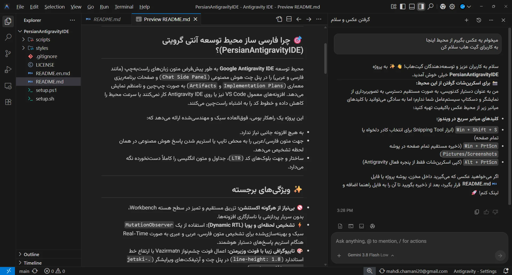

# PersianAntigravity - RTL & Persian Typography for Antigravity 🇮🇷 🇦🇪

> **Native, Extension-Free Right-to-Left (RTL) & Vazirmatn Font Support Exclusively Crafted for Antigravity IDE & Antigravity App.**

[🇮🇷 مستندات فارسی (Persian)](README.md) | [English Documentation](README.en.md)

[](LICENSE)
[](#)
[](#)

<p align="center">
  
</p>

---

## ⚡ Highlights

- 🚫 **Zero Extensions Required:** Operates natively without bloated or incompatible VS Code extensions.
- 🔄 **Real-Time Dynamic RTL Detection:** Built-in lightweight `MutationObserver` detects Persian, Arabic, and Hebrew characters in real-time as the AI agent streams responses.
- 🎨 **Beautiful Vazirmatn Typography:** Polished typography across the **Chat Side Panel** (`.antigravity-agent-side-panel`), **Implementation Plans**, **Artifacts**, and **Walkthroughs** (`.jetski-custom-editor-pane`).
- 💻 **Strict LTR Code Blocks:** Code blocks (`pre`, `code`, `.interactive-result-code-block`) remain strictly LTR with monospaced font (`JetBrainsMono Nerd Font`), ensuring uncompromised readability.
- 🛡️ **No "Corrupted / Unsupported" Warnings:** Cleanly strips the workbench hash from `product.json` checksums to prevent annoying warning banners.
- 📝 **Markdown Preview RTL:** Preconfigures built-in Markdown preview (`Ctrl+Shift+V`) with RTL direction and Vazirmatn font.
- 🔄 **Clean Rollback & Status Check:** Safely creates `.bak` backups before modifying files; uninstall restores the original state with one command.

---

## 🚀 Quick Start (One-Liner Installation)

### Linux & macOS

Run the installer via `curl`:

```bash
curl -fsSL https://raw.githubusercontent.com/mehdichamani/PersianAntigravity/main/setup.sh | bash
```

> 💡 *Note:* If Antigravity IDE is installed in a system directory (such as `/opt/`), the script will automatically request `sudo` elevation if needed. You can also pipe directly into `sudo bash`:
> ```bash
> curl -fsSL https://raw.githubusercontent.com/mehdichamani/PersianAntigravity/main/setup.sh | sudo bash
> ```

### Windows (PowerShell 7+)

Run the installer in PowerShell:

```powershell
irm https://raw.githubusercontent.com/mehdichamani/PersianAntigravity/main/setup.ps1 | iex
```

*After installation, restart Antigravity to apply visual changes.*

---

## 💻 Local Clone & Manual Usage

If you prefer to clone the repository locally:

```bash
git clone https://github.com/mehdichamani/PersianAntigravity.git ~/projects/PersianAntigravity
cd ~/projects/PersianAntigravity
```

### Linux / macOS (`setup.sh`)

```bash
# Check current installation status (both Antigravity IDE and App)
./setup.sh status

# Install / Apply patches to all targets (IDE & App)
./setup.sh install

# Target Antigravity App specifically
./setup.sh install --target=app

# Target Antigravity IDE specifically
./setup.sh install --target=ide

# Setup 'antigravity-proxy' command and Desktop shortcut
./setup.sh proxy

# Uninstall / Restore original state
./setup.sh uninstall
# Or restore App specifically:
./setup.sh uninstall --target=app
```

> **Note on Permissions:** Core Antigravity IDE files on Linux reside in `/opt/antigravity-ide/`. The script automatically prompts for `sudo` elevation only when modifying system files; patching Antigravity App in the user directory requires no sudo.

### Windows (`setup.ps1`)

```powershell
# Check current status
pwsh -File ./setup.ps1 -Status

# Install / Apply patches to all targets
pwsh -File ./setup.ps1 -Install

# Target Antigravity App specifically
pwsh -File ./setup.ps1 -Install -Target app

# Setup Desktop shortcut with automatic System Proxy injection
pwsh -File ./setup.ps1 -ProxyLauncher

# Uninstall / Revert
pwsh -File ./setup.ps1 -Uninstall
```

---

## 🌐 System Proxy Integration

To solve connectivity restrictions and sanctions seamlessly, smart proxy launchers are provided in `scripts/`:
- **Auto-Detection:** Automatically extracts active system proxy settings on Windows (via Registry), GNOME (`gsettings`), KDE Plasma (`kreadconfig`), and macOS (`scutil`).
- **Environment Injection:** Dynamically populates `HTTP_PROXY`, `HTTPS_PROXY`, `ALL_PROXY`, and `NO_PROXY` within the IDE process session without modifying global system settings.
- **Usage:**
  - **Windows:** Run `scripts/antigravity-proxy.bat` directly, or run `setup.ps1 -ProxyLauncher` to generate a dedicated desktop shortcut.
  - **Linux / macOS:** Run `scripts/antigravity-proxy.sh` directly, or run `./setup.sh proxy` to install the `antigravity-proxy` CLI command and application menu launcher.

---

## 📁 Project Structure

```
PersianAntigravity/
├── .gitignore
├── LICENSE                          # MIT License
├── README.md                        # Persian Documentation (مستندات فارسی)
├── README.en.md                     # English Documentation
├── setup.sh                         # Linux/macOS installation script
├── setup.ps1                        # Windows PowerShell installation script
├── styles/
│   ├── antigravity-chat-rtl.css     # Workbench chat & artifact stylesheet
│   └── markdown-rtl.css             # User Markdown preview stylesheet
└── scripts/
    ├── antigravity-chat-rtl.js      # MutationObserver real-time RTL script
    ├── antigravity-proxy.ps1        # Windows registry proxy injector script
    ├── antigravity-proxy.bat        # Windows silent background launcher
    └── antigravity-proxy.sh         # Linux/macOS universal proxy launcher
```

---

## ⚙️ How It Works

1. **Workbench Injection:** The installer injects links to `antigravity-chat-rtl.css` and `antigravity-chat-rtl.js` directly into `out/vs/code/electron-browser/workbench/workbench.html`.
2. **Dynamic Mutation Observer:** `antigravity-chat-rtl.js` listens to DOM subtree updates. Whenever text matches Persian/Arabic Unicode ranges (`[\u0600-\u06FF...]`), it applies the `.antigravity-is-rtl` class.
3. **Typography & Spacing:** `antigravity-chat-rtl.css` increases line height (`line-height: 1.8`), refines list paddings for RTL numbering, and forces code blocks and tables to maintain LTR formatting.
4. **Checksum Bypass:** Electron-based VS Code applications verify file integrity against hashes in `product.json`. The script safely removes `workbench.html` from `checksums`, completely silencing the *"Your installation is corrupt"* warning.
5. **Markdown Preview:** Injects `markdown-rtl.css` into `~/.config/Antigravity IDE/User/settings.json` under `markdown.styles`.

---

## 🔤 Prerequisites: Vazirmatn Font

For the best experience, ensure the **Vazirmatn** font is installed on your operating system:

- **Arch / Omarchy Linux:**
  ```bash
  yay -S --needed ttf-vazirmatn
  ```
- **Debian / Ubuntu:**
  ```bash
  sudo apt install fonts-vazirmatn
  ```
- **Windows:** Download and install from [Google Fonts - Vazirmatn](https://fonts.google.com/specimen/Vazirmatn) or GitHub releases.

---

## 📄 License

This project is licensed under the [MIT License](LICENSE) - see the LICENSE file for details.

Developed with ❤️ by [Mehdi Chamani](https://github.com/mehdichamani).
